<!-- Delhi Night Banner Header -->

 

<!-- Micro Developer Cycle Animation -->

  

<!-- Fast Contact & Profile Links -->

&nbsp;

&nbsp;

&nbsp;

&nbsp;

 

> *Somewhere in Delhi, probably debugging something that worked five minutes ago.*

---

### 🌙 About Me

I am a **B.Tech Information Technology student at Delhi Technological University (DTU)**, passionate about software engineering, backend systems, databases, and machine learning.

- 💻 **Core Language**: **C++** is my primary language for systems and algorithmic problem solving, paired with **Python** and **SQL** for data pipelines and backend services.
- 🧩 **Problem Solving**: **650+ LeetCode problems solved**, focusing on dynamic programming, graph theory, trees, and optimal data structure choices.
- 🛠️ **Engineering Mindset**: I enjoy benchmarking systems, inspecting buffer usage, and building practical tools that hold up under real-world conditions.
- ☕ **Current Routine**: Solving DSA problems, learning how systems work under the hood, and running on chai and debugging.

---

### 🎓 Education

| Institution | Degree & Specialization | Duration | Performance |
| :--- | :--- | :--- | :--- |
| **Delhi Technological University (DTU)** | B.Tech in Information Technology | 2024 – 2028 | **CGPA: 8.97 / 10.0** |
| **CBSE Class XII** | Science (PCM) | Class of 2024 | **96.2% Aggregate** |

<b>📊 Semester Breakdown & Entrance Examinations</b>

 

- **Semester I**: `9.20 SGPA`
- **Semester II**: `8.80 SGPA`
- **Semester III**: `9.17 SGPA`
- **Semester IV**: `8.73 SGPA`
- **JEE Main 2024**: `99.59 Percentile` · **AIR 6690** (out of ~1.4M candidates)
- **JEE Advanced 2024**: **AIR 8417**

---

### 🛠️ Tech Stack

<table>
  <tr>
    <td width="25%" valign="top"><b>Languages</b></td>
    <td width="75%">
      <code>C++</code> · <code>C</code> · <code>Python</code> · <code>SQL</code> · <code>TypeScript</code> · <code>JavaScript</code>
    </td>
  </tr>
  <tr>
    <td valign="top"><b>Backend & APIs</b></td>
    <td>
      <code>FastAPI</code> · <code>Node.js</code> · <code>Express.js</code> · <code>REST APIs</code>
    </td>
  </tr>
  <tr>
    <td valign="top"><b>Databases & Storage</b></td>
    <td>
      <code>PostgreSQL</code> · <code>MySQL</code> · <code>Firebase</code>
    </td>
  </tr>
  <tr>
    <td valign="top"><b>Data & Machine Learning</b></td>
    <td>
      <code>Polars</code> · <code>Pandas</code> · <code>NumPy</code> · <code>Scikit-learn</code> · <code>Matplotlib</code>
    </td>
  </tr>
  <tr>
    <td valign="top"><b>Tools & Infrastructure</b></td>
    <td>
      <code>Git</code> · <code>GitHub</code> · <code>Docker</code> · <code>Tableau</code> · <code>VS Code API</code>
    </td>
  </tr>
</table>

---

### 🚀 Featured Engineering Projects

#### 1. [PostgreSQL Query Optimization Lab](https://github.com/Akshat-Jain-sudo/Database-project)
> *High-throughput database benchmark & analytical query tuning on 12.87M records.*

- **Data Ingestion**: Ingested and benchmarked 12.87 million NYC Taxi records at 50k–70k rows/s using Polars streaming and PostgreSQL `COPY`.
- **Query Diagnostics**: Diagnosed bottlenecks, heap fetches, and buffer allocations using `EXPLAIN (ANALYZE, BUFFERS)`.
- **Optimization**: Applied B-tree composite indexing, range partitioning, CTE early aggregation, and materialized views.
- **Result**: Reduced a daily zone aggregation query runtime from **10.9 seconds down to 13.7 milliseconds** (**797× speedup**).
- **Stack**: `PostgreSQL 18` · `Python` · `Polars` · `FastAPI` · `React` · `TypeScript` · `pytest`

---

#### 2. [Symbiote — Multi-Platform Price Comparison](https://github.com/Akshat-Jain-sudo/scrape)
> *Real-time price intelligence engine querying 8 e-commerce & quick-commerce platforms.*

- **8-Platform Aggregation**: Scrapes and normalizes pricing across Flipkart, Snapdeal, Croma, Myntra, Ajio, Blinkit, Swiggy Instamart, and Zepto.
- **Resilience**: Engineered rotating request headers, rate-limiting handlers, and a fallback caching layer when live scrapers encounter timeouts or blocks.
- **Analytics**: Interactive dashboard highlighting real-time best deals, discount spreads, and export options in CSV and Excel.
- **Stack**: `React` · `Vite` · `Node.js` · `Express` · `Cheerio` · `Axios` · `json2csv` · `exceljs`

---

#### 3. [IPL Live Win Probability Model](https://github.com/Akshat-Jain-sudo/PW2)
> *Match-state win-probability estimation during second-innings run chases.*

- **Feature Engineering**: Extracted match-state variables from ball-by-ball datasets: runs required, balls remaining, wickets in hand, current run rate, and required run rate.
- **Model Comparison**: Benchmarked calibrated Logistic Regression against Gradient Boosting classifiers.
- **Validation**: Enforced season-based chronological splitting to prevent match-level data leakage, evaluating model performance via log loss and probability calibration curves.
- **Stack**: `Python` · `Pandas` · `NumPy` · `Scikit-learn` · `Matplotlib` · `Cricsheet Data`

---

#### 4. [Code-to-Word](https://github.com/Akshat-Jain-sudo/Code-to-word-extension) — VS Code Documentation Extension
> *Automated generation of university-formatted Word lab manuals (.docx) directly from source code.*

- **Multi-Model AI Router**: Generates code explanations and algorithmic summaries using Google Gemini, OpenAI, Groq, and local Ollama models.
- **Native Document Generation**: Generates clean OpenXML `.docx` files with syntax-highlighted code blocks (Prism.js), AI flowcharts, and custom DTU cover pages.
- **Stack**: `TypeScript` · `VS Code Extension API` · `docx` · `Prism.js` · `Gemini API` · `Ollama`

---

### 🏆 Key Achievements

- **650+ LeetCode Problems Solved** with C++ as primary problem-solving language.
- **JEE Main 2024**: **99.59 Percentile** (AIR 6690 out of ~1.4 million candidates).
- **JEE Advanced 2024**: **AIR 8417** qualified.
- **DTU Academic Excellence**: Information Technology Undergraduate with **8.97 Cumulative CGPA**.

---

### 📜 Certifications

- **Supervised Machine Learning: Regression and Classification** — [DeepLearning.AI / Coursera](https://www.coursera.org/)
- **Databases and SQL for Data Science with Python** — [IBM / Coursera](https://www.coursera.org/)
- **Python** — [Kaggle](https://www.kaggle.com/)
- **Pandas** — [Kaggle](https://www.kaggle.com/)
- **Data Visualization** — [Kaggle](https://www.kaggle.com/)

---

### 📊 GitHub Activity

  
  &nbsp;
  

---

### 📬 Connect With Me

- 💼 **LinkedIn**: [linkedin.com/in/akshat-jain-7b92a5313](https://www.linkedin.com/in/akshat-jain-7b92a5313/)
- ✉️ **Email**: [akshat.jain0411@gmail.com](mailto:akshat.jain0411@gmail.com)
- ⚡ **LeetCode**: [leetcode.com/u/Akshat-Jain-sudo](https://leetcode.com/u/Akshat-Jain-sudo/)
- 🐙 **GitHub**: [github.com/Akshat-Jain-sudo](https://github.com/Akshat-Jain-sudo)
- 🌐 **Portfolio**: [akshat-jain-sudo.github.io/PW2](https://akshat-jain-sudo.github.io/PW2/)

  Designed with the Delhi Night theme • Akshat Jain • DTU IT

